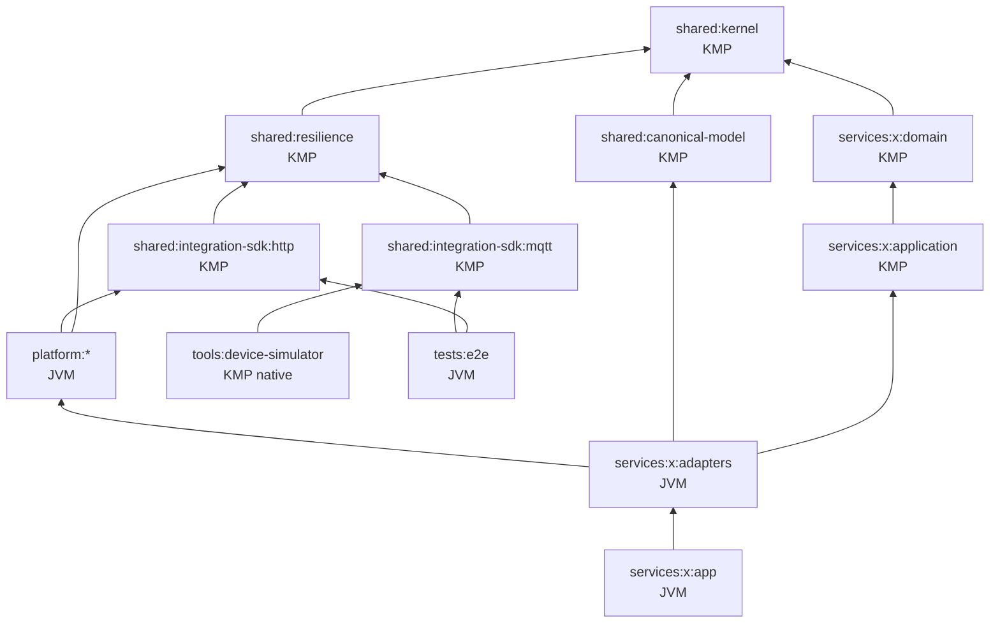

# Module Design

## 1. Gradle モジュール命名
`:shared:kernel`, `:shared:resilience`, `:shared:canonical-model`, `:shared:integration-sdk:http`, `:shared:integration-sdk:mqtt`
`:platform:<name>`, `:services:<service>:{domain,application,adapters,app}`, `:tools:<name>`
`:tools:device-simulator`(KMP: linuxX64 / macosArm64 の実行バイナリ)、`:tests:e2e`(JVM。`e2eTest` タスク。通常の build には含めない)
パッケージ(basePackage は ADR-0001 で決定。既定 `io.eia`):

| 対象 | パッケージ | 例 |
|---|---|---|
| `services/<service>/<layer>` | `<basePackage>.<service>.<layer>`(`<service>` はディレクトリ名から `-` を除いた値) | `io.eia.order.domain`, `io.eia.legacysim.app`(services/legacy-sim) |
| `shared/<module>` | `<basePackage>.shared.<module>` | `io.eia.shared.kernel`, `io.eia.shared.kernel.money` |
| `shared/integration-sdk/<part>` | `<basePackage>.shared.sdk.<part>`(`<part>` は http / mqtt) | `io.eia.shared.sdk.http`, `io.eia.shared.sdk.mqtt` |
| `shared/canonical-model` | `<basePackage>.shared.canonical.<domain>`(ドメイン単位: common / sales / catalog / billing / logistics。ADR-0011) | `io.eia.shared.canonical.sales` |
| `platform/<module>` | `<basePackage>.platform.<module>` | `io.eia.platform.observability` |
| `tools/<module>` | `<basePackage>.tools.<module>` | `io.eia.tools.architecture` |

Konsist はパッケージでレイヤを判定するため、配置(`services/<service>/<layer>/`)とパッケージの一致も検査する(ADR-0010)。
Kotlin のパッケージ名に `-` は使えないため、サービスのパッケージはディレクトリ名から `-` を除く(`ArchitectureRules.servicePackage`。`platform/messaging-kafka` → `messagingkafka` と同じ規則)。

ターゲット構成と JVM 専用ライブラリの配置は ADR-0004 に従う。

| モジュール | 種別 | ターゲット |
|---|---|---|
| `shared/kernel`, `shared/resilience`, `shared/canonical-model`, `shared/integration-sdk/http` | KMP | jvm, js(IR), linuxX64, macosArm64 |
| `shared/integration-sdk/mqtt` | KMP(`eia.kmp-socket-library`) | jvm, linuxX64, macosArm64(js は持たない。ブラウザからは TCP のソケットを開けない。ADR-0038 §2)。実際の Mosquitto に対する統合テストは jvm の `integrationTest`(src/integrationTest/kotlin) |
| `services/*/domain`, `services/*/application` | KMP(commonMain) | jvm のみ(`eia.kmp-domain` の DSL で追加可能) |
| `tools/device-simulator` | KMP(`eia.kmp-native-tool`) | linuxX64, macosArm64(実行ファイル)。jvm はテストとカバレッジだけ |
| `platform/*`, `services/*/{adapters,app}`, `tools/*`(上記以外), `tests/e2e` | JVM | — |

## 2. 依存関係

- `platform:*` は `services:*` に依存しない。
- `services:*:domain` と `services:*:application` は `shared:canonical-model` に依存しない。domain はサービス独自のモデルとし、Canonical Model との変換は adapters で行う(ADR-0010 Decision 7。Konsist の `canonicalModelOutsideDomainAndApplication`)。
- `platform` のモジュール間の本番の依存(import・完全修飾名・`api` / `implementation` などの宣言)は、次の一覧だけを許可し、循環を禁止する(Konsist の `PlatformDependencyRules`)。テストのソースセットと `testImplementation` などの依存は対象外。一覧を変えるときは、`PlatformDependencyRules.ALLOWED` とこの表を同時に更新する。

  | 依存元 | 依存先 | 理由 |
  |---|---|---|
  | `platform:audit` | `platform:security` | S3 の資格情報を `SecretProvider` から取る(ADR-0008・ADR-0019 §6) |
  | `platform:audit` | `platform:observability` | details の値のマスキング(ADR-0018 §3) |
  | `platform:batch` | `platform:file-transfer` | ファイルの到着の監視の置き場(`ObjectReader`)とマニフェスト(`FileManifest`)(ADR-0030 §4・ADR-0032 §1) |
  | `platform:batch` | `platform:observability` | 実行・ステップの span と traceparent の引き継ぎ(ADR-0030 §5・ADR-0018 §2) |
  | `platform:security` | `platform:api` | 401 / 403 / 503 を Problem Details で返す(ADR-0019 §5・ADR-0022 §2) |
  | `platform:api` | `platform:observability` | Problem Details の `correlationId`(ADR-0022 §2) |
  | `platform:messaging-kafka` | `platform:schema-registry` | 書き込みのスキーマ ID(起動時に解決したもの)と受信時の書き手のスキーマ(ADR-0025 §3) |
  | `platform:messaging-kafka` | `platform:observability` | PRODUCER の span と Correlation ID(ADR-0025 §4・ADR-0018 §2) |
  | `platform:outbox` | `platform:messaging-kafka` | 記録のトピック・ヘッダ・ペイロード(`EventTopic`・`EventMetadata`・`AvroEventSerializer`。ADR-0007) |
  | `platform:outbox` | `platform:observability` | 記録を作るときの PRODUCER の span と Correlation ID(ADR-0018 §2) |
  | `platform:file-transfer` | `platform:security` | S3 の資格情報を `SecretProvider` から取る(ADR-0032 §1・ADR-0019 §6) |
  | `platform:webhook` | `platform:security` | 署名の鍵を `Secret` で受け取る(値を伏せる。ADR-0035 §2・ADR-0019 §6) |
- Kafka のクライアントと avro4k を本番コードで使ってよいのは `platform:messaging-kafka` と `services:*:adapters`・`app` だけ(`org.apache.avro` は tools も可)。Apicurio の公式のライブラリはテストだけ(ADR-0025 §5。Konsist の `messagingLibrariesOnlyInAllowedModules`)。
- AWS SDK を本番コードで使ってよいのは `platform:file-transfer` と `platform:audit` のアンカー(`anchor` パッケージ)だけ。Parquet と Hadoop は `platform:file-transfer` だけ(計測の `tools/parquet-bench` を除く)。SFTP のクライアント(sshj)と OpenPGP(bcpg)は `platform:file-transfer` だけ(テスト用の鍵を作る `platform:test-support` を除く。ADR-0032 §8。Konsist の `transferSecurityOnlyInFileTransfer`)。依存の宣言(`libs.aws.*`・`libs.parquet.*`・`libs.hadoop.*`・`libs.sshj`・`libs.bouncycastle.pg`)も同じ範囲に限り、Hadoop は `compileOnly` だけにする(ADR-0032 §6・ADR-0033 §3。Konsist の `awsSdkOnlyInAllowedModules`・`parquetOnlyInFileTransfer`・`LibraryDeclarationRules`。実行時のクラスパスは `platform:file-transfer` の `verifyNoHadoopAtRuntime` でも検査する)。
- `platform:test-support` はテストのソースセット(`test` / `integrationTest` など)からだけ参照する。
- `services` 間のコード依存は禁止(連携は契約経由のみ)。契約モデルは contracts から生成するか `adapters` 内で定義する。
- `tests:e2e` は `services:*` にコード依存しない(契約・SDK・公開エンドポイント経由のみで検証する)。公開エンドポイント(Gateway・Keycloak・Tempo・Prometheus・Grafana)には JDK の HttpClient で接続し、client-credentials のトークンの取得だけは P11 ②b から `shared:integration-sdk:http` の `ClientCredentialsTokenProvider` を使う(ADR-0037 §5)。ソースは `src/e2eTest/kotlin`、実行は `make e2e`(起動した基盤に対して)と ci の `e2e` ジョブ。
- `platform:security` は `shared:integration-sdk:http` に依存する(Client Credentials のトークンの取得の中身とスコープの形式を SDK と共有する。ADR-0037 §2)。`HttpCallClassifier`・`RetryAfter` も SDK にある(`platform:reliability` は `ResilienceMetrics` だけ)。
- `tools:device-simulator` は SDK の中の `shared:integration-sdk:mqtt` にのみ依存する(HTTP の部分の Curl のエンジン(libcurl)を native のバイナリに巻き込まない。ADR-0039 §1。Konsist の `deviceSimulatorDependencies` が import と build.gradle.kts の `project(...)` を検査する)。
- SDK は HTTP の部分(`shared:integration-sdk:http`。Ktor Client。ADR-0037)と MQTT の部分(`shared:integration-sdk:mqtt`。ADR-0038)に分け、互いに依存しない。リトライ・traceparent は `shared:resilience`、待ち時間の計算は `shared:kernel` の `RetryPolicy` を使う(同じ処理を SDK に作らない)。

## 3. サービス内部レイアウト(例: order)
```
services/order/
  domain/src/commonMain/kotlin/io/eia/order/domain/          # package io.eia.order.domain
    Order.kt, OrderLine.kt, OrderStatus.kt, Identifiers.kt, ShippingAddress.kt   # 状態遷移は docs/architecture/order-state-machine.md
    OrderSaga.kt(Saga の状態・受け取るもの・遷移表 OrderSagaRules。純粋な関数。docs/architecture/order-saga.md・ADR-0029)
    BusinessDay.kt(業務の 1 日 = 日本時間の区切りと、日次の集計のハッシュの行の形式 DailyOrderDigest。ADR-0031 §1・§3)
  application/src/commonMain/kotlin/io/eia/order/application/ # package io.eia.order.application
    port/inbound/PlaceOrderUseCase.kt, HandleSagaReplyUseCase.kt, TimeoutSagasUseCase.kt   # `in` は Kotlin の予約語のため inbound / outbound とする
    port/outbound/OrderRepository.kt(楽観的ロック), TransactionRunner.kt, OrderIdGenerator.kt, OrderAuditTrail.kt, OrderEventOutbox.kt(P06。Outbox でイベントを書く)   # IdempotencyStore は platform/api(ADR-0022 §1)
    port/outbound/SagaPorts.kt(P07。SagaStore(期限は DB の時計)・SagaCommandOutbox・ProcessedReplies・SagaIdGenerator・SagaObserver)
    usecase/PlaceOrderService.kt, GetOrderService.kt, GetDailyOrderSummaryService.kt(日次の集計。Port は port/outbound/OrderSummaries.kt)
    usecase/SagaCoordinator.kt(遷移表の判定を、注文・Saga・コマンド・イベントの書き込みにする。SagaTimeouts), HandleSagaReplyService.kt, TimeoutSagasService.kt   # ADR-0029
  adapters/src/main/kotlin/io/eia/order/adapters/             # package io.eia.order.adapters
    inbound/rest/OrderRoutes.kt, OrderDtos.kt, OrderDtoMapper.kt, OrderProblems.kt   # `in` は予約語(ktlint はバッククォートのパッケージ名を許さない)
    out/persistence/ExposedOrderRepository.kt, ExposedTransactionRunner.kt, OrderSchema.kt(order と監査のマイグレーション),
                    UuidV7OrderIdGenerator.kt, PostgresIdempotencyStore.kt, ExposedTransactionBoundary.kt(冪等。ADR-0022 §3),
    out/outbox/OutboxOrderEvents.kt(OrderEventOutbox の実装)、OrderEventMapper.kt(domain → Canonical Model → イベントの型)、
                    OrderCreatedV1.kt(契約の record 名の @SerialName。ADR-0025 §1)、OrderEventSchemas.kt(トピックと、contracts からコピーした契約のスキーマ)
    inbound/kafka/SagaReplyHandlers.kt(返信の購読。Consumer Group order.saga), SagaRepliesV1.kt(返信の型。UNKNOWN は DLQ)   # P07。ADR-0028・ADR-0029
    out/saga/ExposedSagaStore.kt(order_saga。期限は clock_timestamp()、期限切れは FOR UPDATE SKIP LOCKED), OutboxSagaCommands.kt, SagaCommandsV1.kt,
                    SagaSchemas.kt, SagaMetrics.kt(eia.saga.*), SagaSupport.kt(InboxProcessedReplies・UuidV7SagaIds)
  adapters/src/main/resources/db/order/                       # Flyway(所有者のロールで適用。アプリのロールには必要な権限だけを付ける)
  app/src/main/kotlin/io/eia/order/app/                       # package io.eia.order.app
    Main.kt(migrate / serve), OrderCommands.kt, OrderServer.kt(Netty), OrderModule.kt(Koin), OrderConfig.kt   # ADR-0024
                    # P07: OrderServer が返信の読み取り(1 スレッド)と期限切れの定期のジョブを動かす。ORDER_KAFKA_BOOTSTRAP がなければ返信を読まない
    # API の mTLS(ADR-0024 §6)は platform/security の tls パッケージ(ServerTls・ClientCertificateAllowList・mutualTlsConnectors・overTls / overPlaintext)を使う
  app/Dockerfile                                              # distroless の nonroot。ADR-0024 §7
```

**例外: レガシーの模擬(`services/legacy-sim`)は `app` の 1 モジュールだけ**(ADR-0026 §1)。改修できないレガシーの模擬で、業務のロジックを持たず、表のマイグレーション(`db/legacy`。V1 はレガシーの表、V2 は DBA の CDC の設定)と、レガシーのアプリの操作(`simulate`)だけを持つ。変換の知識(Anti-Corruption Layer)は持たない。ACL は連携する側の別のサービス(`services/legacy-order-acl`。4 モジュール。P06 ⑤b)に置く。理由は ADR-0026 §1(ACL は連携する側の責務で、改修できないレガシーには置けない。Framework 8.3 は CDC と変換を別の段に分ける)。
```
services/legacy-sim/app/
  src/main/kotlin/io/eia/legacysim/app/   Main.kt(migrate / simulate), LegacySimCommands.kt, LegacySimConfig.kt, LegacySchema.kt(Flyway), LegacyJuchuApp.kt(レガシーのアプリの模擬)
  src/main/resources/db/legacy/           V1__legacy_schema.sql(t_juchu), V2__dba_cdc_setup.sql(REPLICA IDENTITY FULL・権限・signal 表・publication)
  src/integrationTest/                     LegacyCdcIT(legacy-sim → Debezium → 生の CDC のトピック)
  Dockerfile                               migrate / simulate(make up PROFILE=cdc・make legacy-simulate)
```

**例外: SaaS の模擬(`services/saas-mock`)も `app` の 1 モジュールだけ**(ADR-0035)。自分たちの業務のサービスではなく外部のシステム(CRM)の代わりで、外部の契約(`contracts/external/crm-api.v1.yaml`)を実装するだけの業務のロジックを持たない。状態はメモリの上だけ(再起動で消える)。
```
services/saas-mock/app/
  src/main/kotlin/io/eia/saasmock/app/   Main.kt, SaasMockServer.kt(起動・Webhook を送るループ), SaasMockConfig.kt, SaasMock.kt(CRM の API。ページング・Rate Limit),
                                          AdminRoutes.kt(管理の API: 顧客の作成・変更・Webhook の状態と送り直し・Rate Limit の変更), HttpSupport.kt(トークンの認証・エラーの本文),
                                          CrmCustomers.kt(顧客と版), RateLimiter.kt(Token Bucket。429 と Retry-After), WebhookDispatcher.kt(署名・再送のたびに新しい時刻で署名し直す・鍵の差し替えの間は新旧の両方で署名)
  Dockerfile                             make up PROFILE=saas(P10 ⑥)
```

**永続化の方針**(全サービスで揃える):
- Exposed はトランザクションの管理に使い、ロックの意味が重要な SQL(楽観的ロック、`ON CONFLICT` など)は PreparedStatement で直接書く(`platform/audit` と同じ書き方。ADR-0017)。
- マイグレーションは DB の所有者のロール(`{service}`)で適用し、アプリはマイグレーションが権限を付けたロール(`{service}_app`。所有者の権限を持たない)で接続する。監査の表(`AuditSchema`)も同じ DB に適用する。
- SQL の例外は SQLSTATE で Retryable / NonRetryable に分類し、ドライバのメッセージ(行の値を含みうる)はエラーに入れない。

## 3.1 Gradle 以外のディレクトリ
| パス | 内容 | 命名 |
|---|---|---|
| `contracts/files/` | ファイル I/F 仕様・manifest スキーマ・EDI サブセット定義 | `{system}_{dataset}.v{n}.yaml`, `manifest.v1.schema.json`, `edi/edifact-orders.v1.yaml` |
| `docs/runbooks/` | アラートに紐づく運用手順(Framework 13.1・14.1) | `{channel}-{operation}.md` 例: `event-dlq-replay.md` |
| `docs/reports/` | DoD の証跡となる計測・検証結果 | `{phase}-{topic}.md` 例: `p14-resilience.md` |

## 4. サービス・プラットフォーム一覧
| サービス | 役割 | 主な連携方式 |
|---|---|---|
| order | 受注 API・Saga Orchestrator | REST, Outbox/CDC, Kafka |
| inventory | 在庫引当(注文 Saga の参加者。P07 ④a。ADR-0029)。domain に引当の規則(`InventoryRules`。全部の明細を引き当てられるときだけ引き当てる・Saga ID の記録から返事を返し直す・解放が先に届いたら「取消済み」の印)と保持期間(`SettledRetention`。30 日、14 日未満は拒否)、application に引当・解放・保持期間の削除のユースケースと Port、adapters にコマンドの受信(`InventoryCommandHandlers`。`EventConsumer`・`inventory.command`)・JDBC の在庫(SKU の順にロック。`0 <= reserved <= on_hand` の制約)と引当の記録・冪等消費(`platform/inbox`)・返事の Outbox、app に起動・削除のジョブ・ヘルスチェック | Kafka(コマンド INT-INVENTORY-001 → 返事 INT-INVENTORY-002。Outbox + Debezium)。gRPC は P13 |
| payment | 決済の承認(模擬。注文 Saga の参加者。P07 ④b。ADR-0029)。domain に承認の規則(`PaymentRules`。上限(既定 1,000,000 円)以下で同じ通貨なら承認・Saga ID の記録から返し直す・取消が先に届いたら「取消済み」の印)、adapters にコマンドの受信(`PaymentCommandHandlers`。`payment.command`)・承認の記録(顧客 ID は記録しない)・返事の Outbox。構成は inventory と同じ | Kafka(コマンド INT-PAYMENT-001 → 返事 INT-PAYMENT-002。Outbox + Debezium) |
| shipping | 出荷(模擬。注文 Saga の参加者。P07 ④b。ADR-0029)。domain に出荷の規則(`ShippingRules`。出荷できる国(既定 JP)なら直ちに出荷・出荷の後の取消は `ALREADY_SHIPPED`・取消が先に届いたら「取消済み」の印)、adapters にコマンドの受信(`ShippingCommandHandlers`。`shipping.command`)・出荷の記録(届け先は国だけ。書き換えないので行をロックしない)・返事の Outbox。構成は inventory と同じ | Kafka(コマンド INT-SHIPPING-001 → 返事 INT-SHIPPING-002。Outbox + Debezium) |
| legacy-sim | レガシー基幹 DB 模擬(改修できないレガシー。表と `simulate` だけ。1 モジュール。ADR-0026) | CDC(生の CDC のトピック `_cdc.legacy.*`) |
| legacy-order-acl | レガシーの受注の CDC の Anti-Corruption Layer(状態を持たない変換・DLQ。P06 ⑤b。ADR-0026)。4 モジュール。domain に変換の規則(`LegacyOrderTranslation`)、application にユースケースと発行の Port、adapters に Debezium の Envelope の型・読み取りの処理(`LegacyChangeHandler`。読み取り・コミット・DLQ は platform/messaging-kafka の `EventConsumer` の外部のトピックの購読。#88)・発行(`KafkaLegacyOrderStatePublisher`)、app に起動とヘルスチェック。照合(P06 ⑥。ADR-0027): domain に `LegacyOrderFingerprint`、application に `ReconcileLegacyOrdersUseCase` と Port(`LegacySource`・`PublishedLegacyOrders`)、adapters に `reconcile/`(`JdbcLegacySource`・`KafkaPublishedLegacyOrders`・`ReconcileMetrics`)、app に定期の照合(`ReconcileJob`)と `reconcile` のサブコマンド。再同期(P06 ⑥b): application に `ResyncLegacyOrdersUseCase`(上限 100 件)、adapters に `JdbcSnapshotRequests`(signal 表)・`KafkaReconcileTombstones`(照合の tombstone)。レガシーの DB は読み取り専用のロールで読む(ADR-0027 §1 の例外) | CDC → Kafka(`sales.legacy-order.changed.v1`。INT-SALES-003) |
| batch-etl | 分析基盤への ELT/ETL(ADR-0031)と日次の売上ファイルの送り手(P09)。注文のイベントを日次の DAG で取り込み(住所はロードの前に地域に変える ETL)、日本時間の日次のパーティションを SQL で置換して作る(ELT)。遅れて届いたデータは 31 日前まで作り直す。週次の Full 照合(order-service の日次の集計を Gateway 経由で読み、件数とハッシュを比べる。38 日分)。日次の DAG の完了の後に、日次の売上ファイル(INT-SALES-004。Parquet / CSV + gzip を S3 互換ストレージに置く。ADR-0031 §8)を書く。コマンドは `migrate`・`serve`(毎日 01:00 JST に前日の分、毎週月曜 07:00 JST に照合)・`run <yyyy-MM-dd> [--restart]`・`reconcile <yyyy-MM-dd> [--restart]`・`sales-file <yyyy-MM-dd> [--restart]`・`skip-lost-events [--confirm]`(保持期間を超えた回復。ADR-0031 §7)。取り込みの遅れを保持期間に対して監視する | Batch, File(S3 互換ストレージ) |
| file-exchange | ファイル授受(ADR-0032)。P09 ⑤a: 受け口(S3 互換ストレージの `inbox/sales-daily/`)のマニフェストの到着で DAG `file-exchange.receive`(パーティションはファイル名。データファイルがなくても起動)を動かし、検査 → 移動の決定を `received_file` に記録 → archive / quarantine に移す(記録が移動中なら検査をせずに続ける)。serve の中の見回りが、受け取り済みの名前で届いたファイルを送り直し(`duplicate`)・名前の使い回し(`name_reused`)として quarantine の番号ごとの場所に移す(受け取りの実行と同じロック・記録の状態・部分一意索引で排他)。domain に受け取りの記録と理由の規則、application に受け取り・見回りのユースケースと Port(`Inbox`・`ReceivedFiles`・`FileLocks`)、adapters に `S3Inbox`(platform/file-transfer)・`JdbcReceivedFiles`・`BatchFileLocks`・契約の形(`SalesDailyLayout`)、app に起動・見回り・コマンド(`migrate`・`serve`・`receive <名前> [--restart]`・`sweep`)。P09 ⑤b: 受け取りの後のステップ `deliver` で、合格のファイルを取引先の台帳(取引先の ID ごとの送り先・ホスト鍵・PGP の公開鍵。`PartnerRegistry`)に従い、PGP で暗号化・署名して SFTP で送る(`SftpPartnerOutbox`。取引先ごとの Resilience `sftp-{ID}`)。配送の記録 `delivery`(SENDING → SENT)と、送る前の正式名の確認で冪等 | MFT (S3 互換ストレージ/SFTP) |
| saas-mock / webhook-receiver / integration-flow | SaaS 連携(P10。ADR-0035・ADR-0036)。saas-mock(P10 ②): CRM の模擬(外部の契約 `contracts/external/crm-api.v1.yaml` を実装。カーソルのページング・Rate Limit(429 と `Retry-After`)・署名した Webhook の送信(Standard Webhooks。再送のたびに新しい時刻で署名し直す・鍵の差し替えの間は新旧の両方で署名・再送の間隔を設定できる・`webhookDelay` で順序の逆転を作る)・管理の API(E2E が顧客を作る・変える)。1 モジュール)。webhook-receiver(P10 ③。4 モジュール): 署名の検証・受け取りの記録と Outbox(同じトランザクション)・すぐに 204。domain に受け取りの記録(`WebhookReceipt`。本文を持たない)と重複の判定・保持期間(`ReceiptRetention`。既定 30 日)、application に受け取り・保持期間の削除のユースケースと Port(`WebhookReceipts`・`IngestOutbox`)、adapters に受け口(`webhookReceiver`。生のバイト列で platform/webhook の検証・`WebhookSecrets`(`_PREVIOUS` の鍵)・`WebhookMetrics`)・`JdbcWebhookReceipts`・`OutboxWebhookIngest`、app に起動(mTLS の受け口と平文のヘルスチェック)・削除のジョブ・コマンド(`migrate`・`serve`)。integration-flow: Flow の定義(`contracts/flows`)に従い、取り込みのトピックと SaaS の API の定期の同期から Canonical の顧客のイベントを出す。P10 ④(中核): domain に Flow の定義のモデル(`FlowDefinition`・`FlowCatalog`)・元のレコードの値(`SourceValue`。JSON に依存しない)・写し方(`FlowMapper`。決まった変換の一覧だけ)・振り分け・新旧の判定(`VersionDecision`)、application に読み込み(`LoadFlowsUseCase`。Port `FlowDefinitions`)と 1 件の変換(`TransformRecordUseCase`)、adapters に YAML の読み込みと起動時の検証(`YamlFlowDefinitions`。JSON Schema・ファイル名・Canonical の項目)・JSON の読み取り(`JsonRecords`)・Canonical への変換(`CanonicalTypes`)、app に `validate` のコマンド。P10 ⑤(接続): application に Webhook の取り込み(`IngestWebhookUseCase`。冪等消費・新旧の判定・発行を 1 つのトランザクション)と定期の同期(`SyncFlowUseCase`。Watermark)、両方が使う `RecordPublisher`(同じ新旧の記録)、Port(`FlowVersions`・`ProcessedMessages`・`CanonicalPublisher`・`SaasConnector`・`SyncWatermarks`)、adapters に取り込みのトピックの購読(`WebhookIngestHandler`。Flow の event の trigger のトピック・Consumer Group `integration-flow.webhook-ingest`)・`JdbcFlowVersions`・`JdbcSyncWatermarks`・`InboxProcessedMessages`(platform/inbox)・`OutboxCanonicalPublisher`(`sales.customer.changed.v1`)・CRM の Connector(`CrmCustomersConnector`。Resilience `saas-crm`・429 と Retry-After・Tolerant Reader)・`FlowMetrics`、app に `migrate`・`serve`(起動時の検証・購読・Flow ごとの定期の同期・冪等消費の記録の掃除) | REST, Webhook, Kafka(Outbox) |
| iot-bridge | MQTT → Kafka の橋渡し(P11。ADR-0039)。4 モジュール。P11 ⑤a(中核): domain にデバイスの識別(`DeviceAddress`。トピックから取る)・形式の版ごとのペイロード(`DevicePayload`)・1 つの形へのそろえ方(`TelemetryNormalization`。版 1 の温度・湿度を測定値の一覧に)・時計の疑わしさ(`ClockCheck`)・受け付けない理由(`TelemetryRejection`。DLQ の理由)、application に取り込み(`IngestTelemetryUseCase`)と発行の Port(`TelemetryPublisher`)、adapters に JSON の読み取りと形式のスキーマでの検証(`DevicePayloadDecoder`。contracts/devices をリソースに含める)・ce_id(`MessageIds`。`{tenant}/{deviceId}/{boot}/{seq}` の UUID 版 5)。P11 ⑤b: adapters に MQTT の購読(`HiveMqTelemetrySubscriber`。HiveMQ MQTT Client・永続セッション・手動の ack。使ってよいのはこのモジュールだけ(Konsist))・1 件の処理(`TelemetryMessageHandler`。ユーザープロパティの traceparent の子の CONSUMER の span・DLQ・送り直し)・Kafka への発行(`KafkaTelemetryPublisher`。ce_id は UUID 版 5、ce_time とレコードの時刻は受け取った時刻)・メトリクス(`TelemetryMetrics`)。P11 ⑤c: app(`serve`・`reprocess-dlq`。設定・Koin・ヘルスチェック(Ktor CIO。HiveMQ の Netty 4.1 と合わせるため Netty のエンジンは使わない)。ready はスキーマ ID の解決・書くトピックの確認・MQTT の購読・直近の処理が一時的な失敗でないこと)と、DLQ の 1 件の処理し直し方(`TelemetryDeadLetterRedelivery`。デコードからやり直す。読み取り・条件・上限・dry-run は platform/messaging-kafka の `DeadLetterReplayer`)。DB を持たない | MQTT(INT-IOT-001)→ Kafka(`iot.telemetry.reported.v1`。INT-IOT-002) |
| b2b-gateway | EDI | SFTP, EDIFACT |
| bff-graphql | フロント集約 | GraphQL |

| platform | 役割 | フェーズ |
|---|---|---|
| observability | OTel の初期化・Ktor の Server / Client プラグイン(traceparent・Correlation ID の伝搬、RED メトリクス)・構造化 JSON ログ・マスキング(ADR-0018)。OTel SDK を使ってよいのはこのモジュールと `services/*/app` だけ(ADR-0004 §4。Konsist) | P04a |
| security | JWT の検証(JWKS)・スコープの認可(`eiaJwt` / `requireScopes`)・Client Credentials のトークン取得(中身は `shared/integration-sdk/http`。ここでは SecretProvider とログをつなぐ。ADR-0037 §2)・`SecretProvider`(ADR-0008・ADR-0019)・API のポートの mTLS(`tls` パッケージ: PEM から作る `ServerTls`(有効期限の確認)・SAN の許可の一覧 `ClientCertificateAllowList`・2 つのコネクタ `mutualTlsConnectors`・ルートの分け方 `overTls` / `overPlaintext`・環境変数の名前 `TlsVariables`(`{PREFIX}_TLS_*`)。ADR-0024 §6)。Nimbus JOSE+JWT を使ってよいのはこのモジュールだけ(Konsist) | P04a |
| audit | 監査記録: 追記専用のテーブル(アプリ用のロールは INSERT / SELECT だけ。トリガーでも拒否)とハッシュチェーン、S3 互換ストレージの Object Lock(COMPLIANCE)へのアンカー、チェーンとアンカーの検証(ADR-0017)。検査は `tools/audit-verify`(`make audit-verify`)。`java.time` と `java.sql` を使う JVM の部品なので、services の application に Port(例 `AuditTrail`)を置き、adapters で `AuditLog.appendAudit`(業務と同じ Exposed のトランザクション)に写す | P04a |
| test-support | テスト専用。mTLS のテストの CA と証明書(`TestPki`。gen-dev-certs.sh と同じ形)。`infra/local/images.env` のイメージを Testcontainers で使う `InfraImages`(ADR-0016 §5)と、compose と同じ構成のコンテナ(`SeaweedFsContainer`・`SftpServerContainer`・`ApicurioRegistryContainer`・`KafkaConnectContainer`。Connect のイメージは docker の CLI で組み立てる)、テスト用の SSH・PGP の鍵(`TestKeys`)。test / integrationTest からだけ参照する(Konsist) | P04a |
| api | REST の共通部品: Problem Details(RFC 9457。`installProblemDetails` / `respondError`。`type` の一覧は INTEGRATION_STANDARDS §6)と Idempotency-Key(`respondIdempotently` / `IdempotencyHandler` / Port `IdempotencyStore`。PostgreSQL の実装は各サービスの adapters)(ADR-0022) | P05 |
| reliability | `shared/resilience` の JVM 向けアダプタ: OTel のメトリクス(`ResilienceMetrics`。ADR-0021 §7・§11)。OTel は API だけを使う。Ktor Client の結果の分類(`HttpCallClassifier`)と `Retry-After` の解析は、P11 ②a で `shared/integration-sdk/http` に移した(KMP で共有。ADR-0037 §2) | P04b |
| inbox | 冪等消費の記録(ADR-0028 §3)。`Inbox.markProcessed` / `markProcessedIn`(業務と同じ Exposed のトランザクションで `inbox.processed_message` に `(consumer_group, ce_id)` を `INSERT ... ON CONFLICT DO NOTHING`。重複なら `DUPLICATE`。自動コミットでは書かない)、`Inbox.purgeExpired`(DB の時計で保持期間(既定 14 日)を過ぎた行を古い順に消す)、`InboxSchema`(スキーマ `inbox`・権限。サービスの migrate で所有者が適用する)。Kafka にも他の platform にも依存しない | P07 |
| outbox | Transactional Outbox(ADR-0007)。`Outbox.append` / `appendOutbox`(業務と同じ Exposed のトランザクションで INSERT し、同じ行を DELETE する既定の方式。自動コミットでは書かない)、`OutboxEvents`(イベントから記録を作る。`{topic} create` の PRODUCER の span・UUIDv7 の `ce_id` = `id`)、`OutboxSchema`(スキーマ `outbox`・権限・publication `eiaf_outbox`。サービスの migrate で所有者が適用する)、`OutboxMetrics`。保持期間の方式は #76 | P06 |
| messaging-kafka | Kafka の共通部品(ADR-0025)。P06: CloudEvents binary mode のヘッダ(`EventMetadata`)・トピック名(`EventTopic`)・Avro の Serde(avro4k。スキーマ ID は Apicurio と同じ形式でペイロードの先頭に埋め込む。`ApicurioWireFormat`・`AvroEventSerializer`・`AvroEventDeserializer`)・DB の更新を伴わない送信の Producer(`EventProducer`。PRODUCER の span)。DB の更新と組み合わせるイベントは Outbox で発行する。tombstone(`EventProducer.sendTombstone`)と DLQ(`DeadLetterPublisher`。`{topic}.dlq`・`eiaf.dlq.*` のヘッダ。INTEGRATION_STANDARDS §2)は P06 ⑤b(最初の利用者は legacy-order-acl)。P07: 型付きの Consumer(`EventConsumer`・`EventSubscription`・`EventHandler`。CloudEvents のヘッダを持たない外部のトピック(レガシーの生の CDC)は `ExternalSubscription`・`RecordHandler`。パーティションごとに届いた順に処理し、処理の後にコミットする At-Least-Once。失敗の種類(`HandlingFailure`: Rejected → DLQ・Transient → 初回 + 3 回のリトライの後に DLQ・Unavailable → DLQ に送らず読み直す)。CONSUMER の span・`ConsumerMetrics`。ADR-0028)。冪等消費の記録は `platform/inbox`。DLQ の Replay(`DeadLetterReplayer`。既定は dry-run・件数の上限は必須・`ce_id` を変えずに元のトピックへ・生の CDC の DLQ は拒否。CLI は `tools/dlq-replay`。ADR-0028 §6) | P06, P07 |
| batch | 軽量 DAG ランナー(ADR-0030): DAG の Kotlin DSL(`dag { step(...) }`)、実行(`BatchRunner`。DAG とパーティションごとに advisory lock で 1 つだけ・成功したステップを飛ばす再開(`RunMode.RESUME`)とやり直し(`RESTART`)・依存のないステップの並列・ステップのリトライ(既定 3 回))、Checkpoint と Watermark(`StepContext`。結果と同じトランザクションで書く `JdbcBatchStore.writeCheckpoint(connection, ...)`)、起動(`BatchScheduler`: 時刻・前段の DAG の完了・`.manifest.json` の到着(置き場は platform/file-transfer の `ObjectReader`))、traceparent の引き継ぎ(起動の情報を実行の記録に保存)、SLA の遅延の予測(`SlaMonitor`。p90 と前段の待ちを含む予測・`eia.batch.sla.slack`)、メトリクス(`BatchMetrics`)。記録はスキーマ `batch`(`BatchSchema`) | P08 |
| file-transfer | ファイル連携の部品(ADR-0032・ADR-0033)。P09 ③a: S3 互換ストレージの置き場(`ObjectReader` / `ObjectStore`・`S3ObjectStore`。用途ごとに権限を絞った identity で使う)、マニフェスト(`FileManifest`)、データファイルの形(`FileLayout`・`FileName`。契約の `contracts/files/*.yaml` をコードにしたもの)、書き出し(`FilePublisher`: Parquet(zstd。Hadoop なし)・CSV + gzip をローカルに書いて件数と SHA-256 を求め、データファイル → マニフェストの順に置く)、受け側の検査(`FileVerifier`: マニフェスト・名前・スキーマの版・形式・欠損・大きさ・SHA-256・列と件数。判定だけを返す)、移動(`FileMover`: archive / quarantine。コピーしてから消す。どこで落ちても同じ移動の呼び直しで収まる)。③b: PGP(`PgpKeys`・`PgpFiles`: 取引先の公開鍵で暗号化・自社の鍵で署名、自社の鍵で復号・取引先の署名を検証)、SFTP の送信(`SftpSender`: sshj。暗号の方式の絞り込み(`SftpAlgorithms`)・事前に登録したホスト鍵だけ(`KnownHosts`)・一時名から正式名へ)。sshj と OpenPGP はこのモジュールだけで使う(Konsist) | P09 |
| schema-registry | Apicurio Registry 3 の REST クライアント(`ApicurioRegistryClient`: 内容からの contentId の解決・ID からのスキーマの取得・登録)、起動時のスキーマ ID の解決(`SchemaIdBook`。リクエストの処理中はレジストリに問い合わせず、未解決の間は `/health/ready` を失敗にする)、書き手のスキーマのキャッシュ(`WriterSchemas`)(ADR-0025 §2・§3)。契約の登録は `tools/schema-publish`(`make schemas`)だけが行い、サービスは自動登録しない | P06 |
| webhook | Webhook の署名(Standard Webhooks。ADR-0035 §2)。送り手の署名(`StandardWebhooks.signatureHeader`。鍵の差し替えの間は新旧の両方で署名)と受け口の検証(`WebhookVerifier`。本文を解析する前に生のバイト列で検証・定数時間の比較・署名の時刻の許容(既定は前後 5 分)・鍵の差し替えの間は 2 つの鍵を受け付ける・拒否の理由 `WebhookRejection`)。送り手は saas-mock、受け口は webhook-receiver(P10 ③) | P10 |

## 5. テスト戦略
| レベル | 対象 | ツール |
|---|---|---|
| Unit | domain / application(Port はフェイク) | kotest (commonTest) |
| Architecture | 依存方向・命名・レイヤ規約・禁止 import・`kotlin.Result` 禁止 | Konsist |
| Contract | 契約 ⇔ 実装の一致、互換性、Canonical ⇔ Avro | tools/contract-check, OpenAPI validator |
| Integration | Adapter ⇔ 実ミドルウェア | Testcontainers |
| E2E / Chaos | シナリオ・障害注入 | tests/e2e (kotest) + docker compose + Toxiproxy |

### 5.1 カバレッジ(Kover)の測り方(Issue #56)
| 対象 | 計測に使うテスト | 閾値の検証 |
|---|---|---|
| 統合テストを持たないモジュール(domain・application・kernel など) | 単体テスト | `./gradlew build`(必須のチェック)で強制する |
| 統合テストを持つモジュール(`src/integrationTest` がある adapters・platform の一部)と、ルートの全体の集約 | 単体テスト + 統合テスト(`integrationTest` で実行された本番コード) | CI の `integration` ジョブ(`./gradlew integrationTest koverVerify -Peia.kover.withIntegrationTests=true`)で強制する。`./gradlew build` では統合テストを動かさず、単体テストだけの値を目安(警告)として出す |

- 閾値は CODING_STANDARDS のとおり(domain / application 90%、それ以外と全体 75%)。統合テストのテストクラス自体は計測の対象外。
- 理由: adapters の本当の検証は、実際のミドルウェアでの統合テスト(Testcontainers)である。単体テストだけで測ると、閾値を満たすために SQL の呼び出しをモックで模しただけのテストが要り、価値が低い割に保守が増える(P05 ④a-1・#55 の経緯)。一方で、`build` で統合テストを毎回動かすと、Docker が要り、build が遅くなる。
- adapters の単体テストは、統合テストで再現できない分岐(並行の削除との競合など)と、DB を使わない純粋な処理(SQL のエラーの分類・ID の採番など)だけに使う。
- `integration` ジョブは、統合テストに関係する変更(ci.yml の paths-filter)があるときだけ動く。動かない PR では、統合テストを持つモジュールの閾値は検証されない(そのモジュールを変えていないため)。
- Debezium(Kafka Connect)のコンテナを起動する統合テスト(`src/integrationTest` で `KafkaConnectContainer` を使うモジュール。今は order・legacy-sim・legacy-order-acl・inventory・payment・shipping の app と platform/test-support)は、同じ Gradle の実行の中で **1 つずつ** 動かす(build-logic の共有のビルドサービス `CdcContainersGate`。`maxParallelUsages = 1`。該当するかはソースから自動で判定する)。モジュールごとの並列の実行(`org.gradle.parallel`)で、PostgreSQL・Kafka・Kafka Connect のコンテナを同時にいくつも立てると、ランナーの資源を取り合って Debezium の取り込みがテストの待ち時間を超えたため(#126)。CI の matrix の別の項目に分けない理由は、order・legacy-sim・legacy-order-acl の app が全体のカバレッジの集約の対象で、同じ実行で測る必要があるため。
